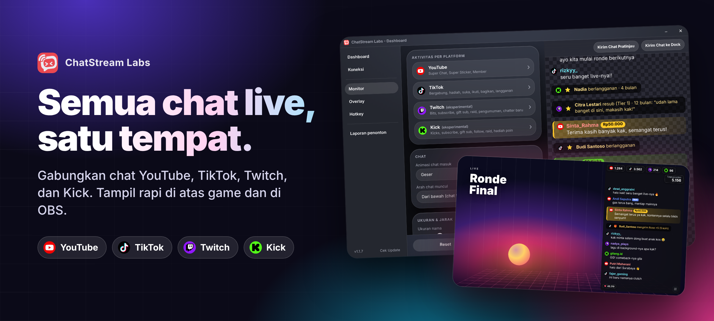
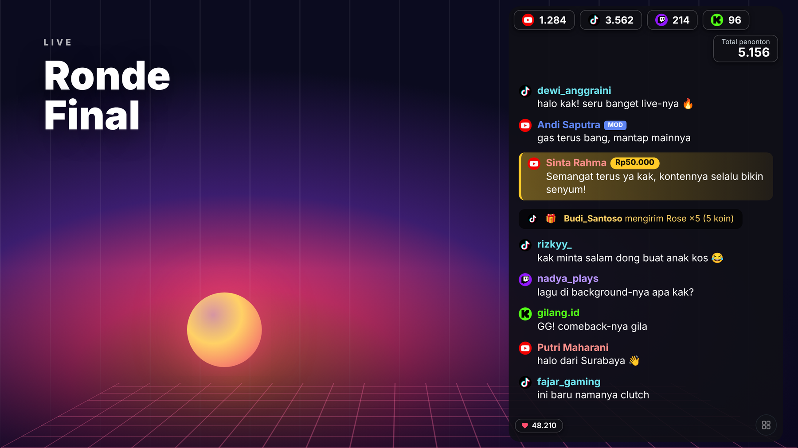
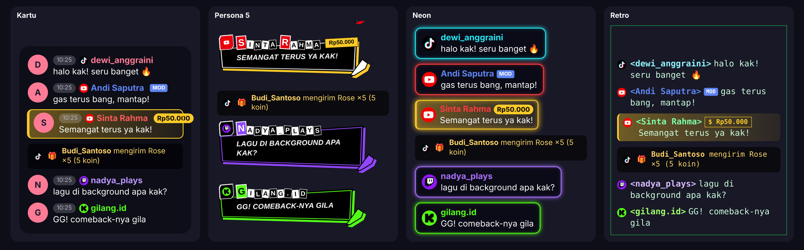
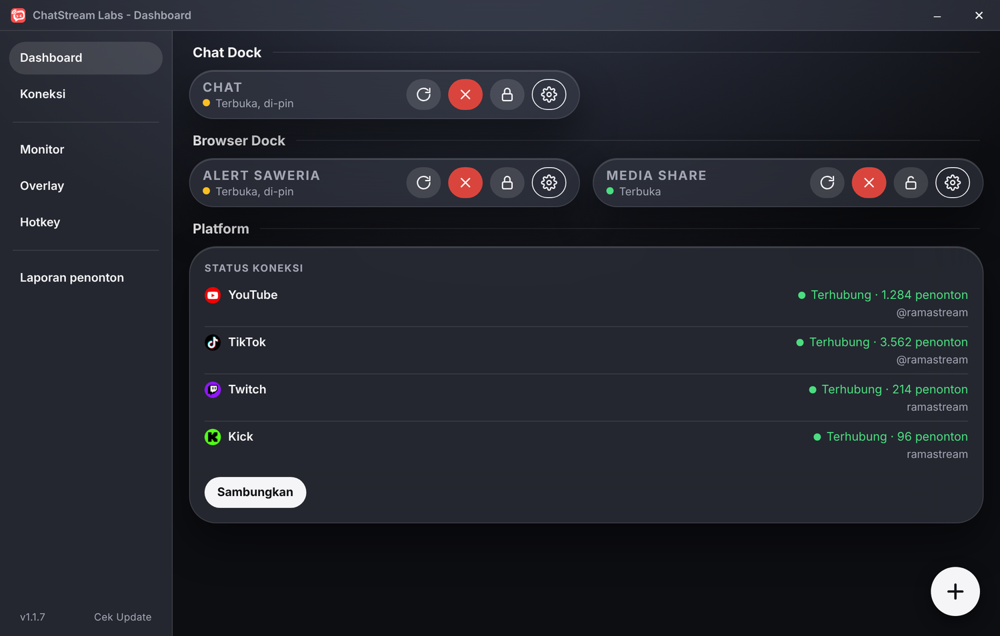
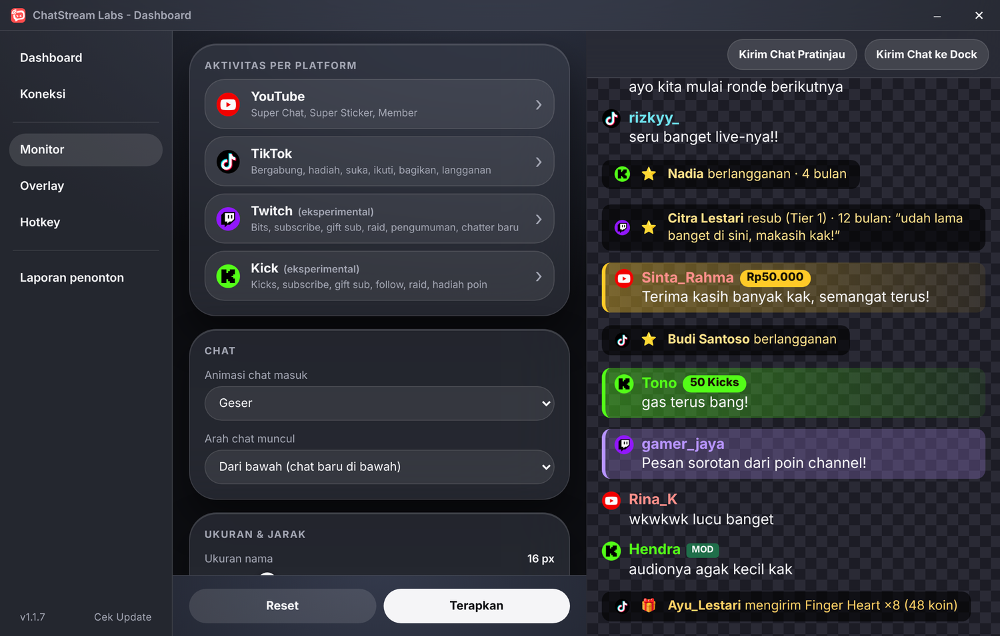
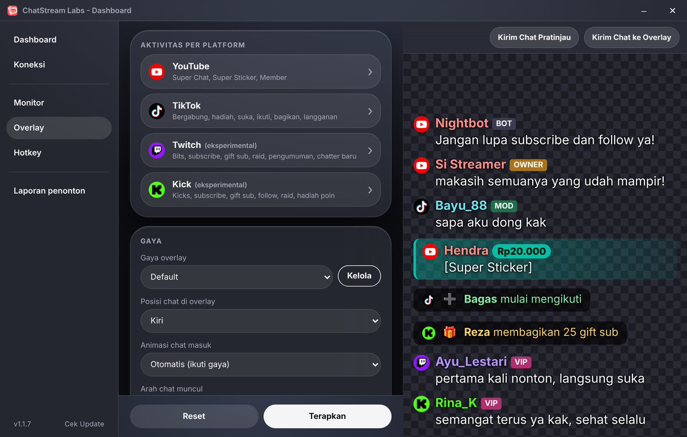

 

**Live di banyak platform tanpa pusing banyak tab.**
Semua chat masuk ke satu aliran yang rapi, tampil di atas game, dan siap dipasang di OBS.

[Chat di atas game](#-chat-melayang-di-atas-game) ·
[Overlay OBS](#-overlay-obs-yang-bikin-channelmu-beda) ·
[Browser Dock](#-browser-dock-widget-donasi-di-atas-game) ·
[Mulai](#-mulai-dalam-3-langkah)

---

## 🎮 Chat melayang di atas game

Chat YouTube, TikTok, Twitch, dan Kick masuk berurutan dalam **satu jendela**. Kunci jendelanya, dan jendela jadi *tembus klik*, jadi game tetap bisa kamu mainkan seolah chat tidak ada.

 

| | |
|---|---|
| 🔒 **Mode kunci** | Transparan, tanpa bingkai, klik tembus ke game |
| 👀 **Sembunyikan dari OBS** | Penonton tidak melihat jendela pribadimu, hanya kamu |
| ⌨️ **Hotkey global** | Kunci, sembunyikan, bersihkan chat, tanpa keluar dari game |
| 📈 **Total penonton** | Jumlah penonton yang sedang menonton, per platform dan gabungan |
| 🏷️ **Label MOD dan BOT** | Mudah membedakan moderator, bot, dan penonton biasa |

---

## 📺 Overlay OBS yang bikin channelmu beda

Pilih gaya yang cocok dengan karaktermu, atau bikin gaya sendiri dengan CSS. Pratinjaunya langsung berubah saat kamu mengatur.

 

- **Satu klik ke OBS.** Overlay ditambahkan otomatis, tidak perlu salin-tempel alamat.
- **Atur sesukamu:** ukuran huruf, jarak, kiri atau kanan, arah muncul, animasi masuk, dan latar chat.
- **Gaya buatan sendiri:** tambah, ubah, dan hapus gaya CSS dengan pratinjau langsung.

---

## 🎁 Momen penting tampil menonjol

<table>
<tr>
<td width="50%" valign="top">

**▶️ YouTube**
Super Chat dan Super Sticker tampil besar lengkap dengan nominal dan warnanya. Member baru juga mendapat sorotan.

**🎵 TikTok**
Hadiah, penonton bergabung, suka, ikuti, bagikan, dan langganan. Tiap jenis bisa diberi warna dan latar sendiri.

</td>
<td width="50%" valign="top">

**🎁 Alert hadiah**
Hadiah TikTok muncul sebagai alert cantik yang ukuran, arah, dan lamanya bisa kamu atur.

**🟣 Twitch dan 🟢 Kick** *(eksperimental)*
Bits, subscribe, gift sub, raid, follow, dan hadiah poin ikut tampil di chat.

</td>
</tr>
</table>

---

## 🔔 Browser Dock: widget donasi di atas game

Tempel URL widget alert atau media share (misalnya **Saweria**), dan widgetnya tampil di jendela sendiri di atas game. Browser Chrome tidak perlu dibuka.

- 🪟 Bisa **lebih dari satu dock**, masing-masing dengan pengaturan sendiri
- 🎚️ **Opacity** isi dan latar yang bisa diatur terpisah
- 🔇 Saklar **bisu**, hotkey, dan menu di tray
- 📌 Ikut **mode kunci**: transparan, tembus klik, tidak mencuri fokus
- 📐 Posisi dan ukuran **diingat**

---

## 🧭 Dashboard: pusat kendali

Semua dikendalikan dari satu tempat: buka dan tutup jendela, pasang widget, cek status tiap platform, dan atur tampilan chat.

 

<table>
<tr>
<td width="50%">

<b>Monitor</b> chat pribadimu, dengan pratinjau langsung

</td>
<td width="50%">

<b>Overlay</b> chat untuk penonton di OBS

</td>
</tr>
</table>

> *Tampilan di atas memakai nama dan chat contoh.*

---

## 📊 Laporan penonton

Setiap sesi live tercatat otomatis. Buka **Laporan penonton** untuk melihat grafik penonton, puncak, rata-rata, jumlah chat, hadiah, Super Chat, dan riwayat tiap sesi.

---

## 🚀 Mulai dalam 3 langkah

1. **Pasang** aplikasinya dari halaman [Releases](../../releases).
2. **Isi username** akun live kamu di Dashboard → *Koneksi*, lalu klik **Sambungkan**.
3. **Buka jendela chat**, atau tambahkan overlay ke OBS. Selesai. 🎉

> 💡 Mau membalas chat dari aplikasi? Ada fitur **Kirim Chat** lewat ekstensi Chrome (*eksperimental*, bawaannya mati). Nyalakan di Dashboard → Koneksi.

---

## ⚠️ Perlu kamu tahu

- Cara mengambil chat YouTube dan TikTok **tidak resmi** dan bisa berhenti bekerja sewaktu-waktu. Memakainya bisa melanggar ketentuan layanan platform, jadi pakai dengan risiko sendiri.
- Aplikasi belum bertanda tangan digital, jadi Windows SmartScreen bisa memberi peringatan saat instal. Pilih **Run anyway** kalau kamu percaya sumbernya.
- Twitch dan Kick masih **eksperimental** dan belum diuji dengan live sungguhan.

---

Dibuat untuk streamer, supaya fokusnya ke konten, bukan ke jendela. 💜

